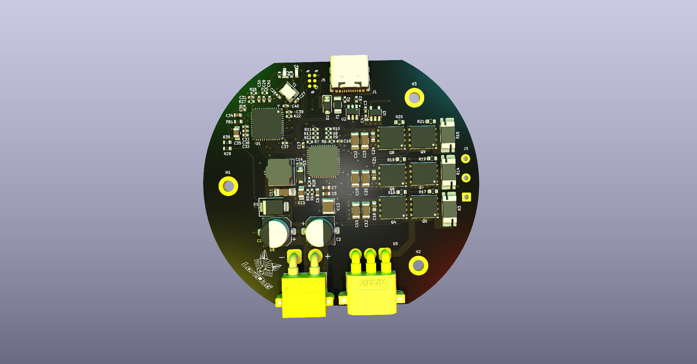
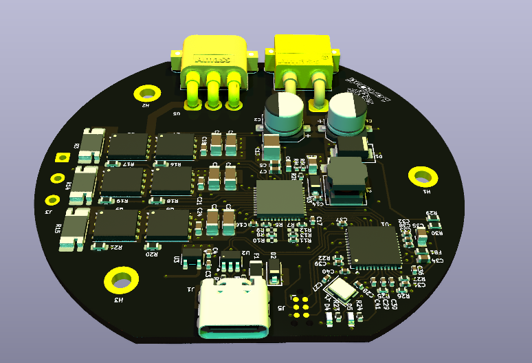

# BLDC-FOC-Motor-Driver


Single-motor **BLDC / PMSM driver with sensored Field-Oriented Control (FOC)**.
It is the motor-control building block for a two-wheeled self-balancing robot, and it also works as a standalone driver on the bench, commanded and monitored over USB.

Rev A is a **test board**: the motor is screwed to the centre of the PCB, with the magnetic encoder sitting right under the motor shaft.

<p align="center">
  
  
</p>


## Key specs

| | |
|---|---|
| Supply | 3S–6S LiPo, designed around **4S** (16.8 V max) |
| Target motor | BGM5208-75T gimbal motor (24N22P, 11 pole pairs, 15 Ω ph-ph, ~1.3 A max on 4S) |
| Control | Sensored FOC, center-aligned PWM at 20 kHz |
| Current sensing | 3-shunt low-side, 50 mΩ + DRV8323 CSA, gain ×10 → ±3.3 A full scale |
| Position feedback | MPS MA730 14-bit magnetic encoder (SPI), centred on the motor shaft |
| Interfaces | USB-C (CDC virtual COM: commands + telemetry), SWD via Tag-Connect TC2030 |
| Logic supply | DRV8323 integrated buck → 5 V → AP2112K LDO → 3.3 V; USB can power the logic for bench work |
| Protection | TVS on VBAT, gate-driver VDS overcurrent, UVLO, thermal shutdown, ESD + polyfuse on USB |

## Architecture

```
VBAT ─► TVS + bulk ─┬─► 3-phase inverter (6× 60 V MOSFET) ─► motor U V W
                    │          │
                    │      3× 50 mΩ low-side shunts ─► DRV8323 CSA ─► ADC (PA0–PA2)
                    │
                    └─► DRV8323RH ── buck ─► +5 V ─► LDO ─► +3V3
                             ▲
STM32G431 ── 6× PWM (TIM1) ──┘   ◄── MA730 encoder (SPI1) · VBAT sense · USB · SWD
```

## Main components

| Block | Part |
|---|---|
| MCU | STM32G431CBU6 (Cortex-M4F 170 MHz, CORDIC), 12 MHz crystal |
| Gate driver | TI DRV8323RH (hardware-strapped config, integrated 5 V buck) |
| Power stage | 6× TI CSD18540Q5B, 60 V, SON 5×6 |
| Current sensing | 3× 50 mΩ 4-terminal (Kelvin) shunts, DRV8323 internal amplifiers |
| Encoder | MPS MA730 + diametral magnet (Ø5 × 3 mm, ~1.5 mm air gap) |
| Supplies | DRV8323 buck (33 µH) → 5 V, AP2112K-3.3 LDO, ferrite-filtered VDDA/VREF+ |
| Protection | SMBJ26A TVS on VBAT, USBLC6-2SC6 ESD on USB, polyfuse + Schottky diode-OR on VBUS |
| Connectors | XT30 (battery), MR30 + solder pads (motor phases), USB-C, Tag-Connect TC2030 |

## Gate driver configuration (hardware straps)

| Pin | Setting | Value |
|---|---|---|
| MODE | tied to GND | 6x PWM |
| IDRIVE | 75 kΩ to GND | 60 mA source / 120 mA sink |
| VDS | tied to GND | 0.06 V trip (≈ 25–30 A with CSD18540Q5B) |
| GAIN | 47 kΩ to GND | ×10 |

Each strap has a spare DNP footprint to DVDD, so the setting can be changed on the bench.

## Current sense

```
V_SO       = VREF/2 + I × R_shunt × G = 1.65 V + I × 0.05 Ω × 10
Full scale = 1.65 V / (G × R_shunt)  = 1.65 V / (10 × 0.05 Ω) = ±3.3 A  (linear ≈ ±2.8 A)
P_shunt    = I² × R_shunt = (1.3 A)² × 0.05 Ω ≈ 85 mW
```

## MCU pinout

| Function | Pins |
|---|---|
| PWM (TIM1) | PA8 / PB13 (A), PA9 / PB14 (B), PA10 / PB15 (C) |
| Driver control | PB5 → EN, PB12 ← nFAULT |
| Phase currents | PA0, PA1, PA2 (ADC1, RC filtered) |
| Battery voltage | PA3 (VBAT / 11) |
| Encoder (SPI1) | PA4 CS, PA5 SCK, PA6 MISO, PA7 MOSI |
| USB | PA11 D−, PA12 D+ |
| Debug | PA13 SWDIO, PA14 SWCLK, PB3 SWO, PG10 NRST |
| LEDs | PC10 status, PC11 fault |

The full configuration is in the STM32CubeMX project (`.ioc`) in the `Firmware` folder.

## Repository structure

```
Firmware/   STM32CubeMX project and firmware
Hardware/   KiCad project (schematic, PCB)
```

## Libraries

This project uses the shared KiCad libraries from L2-Hardware.

1. Clone the library repository **in the same parent folder as your project folders**:

```bash
   git clone https://github.com/L2-Hardware/Kicad_Libs
```

   Expected folder structure:

```
   Kicad/
   ├── Kicad_Libs/
   ├── Project1/
   ├── Project2/
   └── ...
```

2. Inside the project folder, run `bring_libs.bat` to import the libraries into the project.

## Roadmap

- [x] Architecture and component selection
- [x] Schematic: connectors · power · gate driver · inverter · current sense · encoder · MCU
- [ ] ERC clean and footprint assignment
- [ ] PCB layout (4 layers)
- [ ] Fabrication and assembly
- [ ] Bring-up: power rails, SWD, encoder, PWM and dead-time, current-sense calibration
- [ ] Firmware: open loop → current loop → velocity / position loops
- [ ] Rev B: round board mounted on the back of the motor
- [ ] Integration in the self-balancing robot

## Author

Lorenzo Dati
